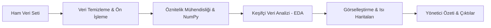

# 📊 Uygulamalı Veri Analizi ve Keşifçi Veri Analitiği Projesi


Bu proje, karmaşık ve gerçek dünya veri kümeleri üzerinde uçtan uca veri temizleme, ön işleme, vektörel hesaplamalar, hipotez bazlı keşifçi veri analizi (EDA) ve görselleştirme süreçlerini gerçekleştirmek amacıyla geliştirilmiştir.

---

## 📌 İçindekiler

- [Proje Hakkında](#-proje-hakkında)
- [Özellikler ve Analiz Adımları](#-özellikler-ve-analiz-adımları)
- [Proje Dizini Yapısı](#-proje-dizini-yapısı)
- [Kurulum ve Çalıştırma](#-kurulum-ve-çalıştırma)
- [Kullanılan Teknolojiler ve Kütüphaneler](#-kullanılan-teknolojiler-ve-kütüphaneler)
- [Veri Analitiği Metodolojisi](#-veri-analitiği-metodolojisi)
- [Ekip ve Rol Dağılımı](#-ekip-ve-rol-dağılımı)
- [Lisans ve İletişim](#-lisans-ve-iletişim)

---

## 🎯 Proje Hakkında

Bu çalışmada, ham veri kaynaklarından elde edilen veriler analiz edilebilir hale getirilmiş; veri kalitesi sorunları (eksik değerler, aykırı gözlemler, hatalı tipler) çözüme kavuşturulmuştur. İstatistiksel yöntemler ve vektörel hesaplamalar ile yeni öznitelikler (*feature engineering*) türetilmiş, iş sorularına yönelik çapraz tablolar ve dinamik grafiklerle karar destek çıktıları üretilmiştir.

### 🏢 Proje Amaçları:
- Ham verideki gürültüyü ve eksiklikleri veri bilimi metodolojileri ile gidermek.
- `NumPy` ve `Pandas` kütüphanelerini kullanarak yüksek performanslı veri manipülasyonu sağlamak.
- Veri seti içerisindeki gizli eğilimleri ve ilişkileri grafiksel (`Matplotlib` / `Seaborn`) olarak ortaya koymak.
- Yönetici özeti ve analitik raporlama ile stratejik kararlara temel oluşturmak.

---

## 🚀 Özellikler ve Analiz Adımları

1. **Veri Kalitesi ve Ön İşleme:**
   - Eksik veri (*Missing Values*) tespiti, medyan/ortalama veya mantıksal doldurma stratejileri.
   - IQR (Interquartile Range) ve Z-Score yöntemleri ile aykırı değer tespiti ve temizliği.
   - Veri tipi dönüşümleri (`datetime`, `categorical`, `numeric`).

2. **Analitik Manipülasyon ve Öznitelik Mühendisliği:**
   - Python kullanıcı tanımlı fonksiyonları ve vektörel hesaplamalar.
   - İleri seviye `groupby`, `pivot_table` ve çoklu filtreleme operasyonları.
   - Veri kümesini zenginleştiren türetilmiş değişkenler (*engineered features*).

3. **Görselleştirme ve Grafik Yorumlama:**
   - Histogram ve KDE dağılım grafikleri.
   - Kutu grafikleri (*Box Plot*) ve aykırı değer analizi.
   - Korelasyon ısı haritaları (*Heatmap*) ve saçılım grafikleri (*Scatter Plot*).
   - Her grafik için sektörel ve analitik bulgu özetleri.

---

## 📂 Proje Dizini Yapısı

```text
├── data/
│   ├── raw/                 # Ham veri seti (CSV / JSON)
│   └── processed/           # Temizlenmiş ve işlenmiş veri seti
├── notebooks/
│   └── main_analysis.ipynb  # Ana Jupyter Notebook analiz dosyası
├── reports/
│   └── Analiz_Raporu.pdf    # Detaylı PDF proje raporu
├── src/
│   ├── __init__.py
│   ├── data_loader.py       # Veri yükleme ve tip düzenleme modülü
│   ├── data_cleaning.py     # Eksik veri ve aykırı değer işleme fonksiyonları
│   └── visualization.py    # Grafik ve görselleştirme fonksiyonları
├── .gitignore               # Git tarafından yoksayılacak dosyalar
├── requirements.txt         # Gerekli Python kütüphaneleri
└── README.md                # Proje dokümantasyonu
```

---

## 🛠 Kurulum ve Çalıştırma

Projeyi yerel bilgisayarınızda çalıştırmak için aşağıdaki adımları sırasıyla takip edebilirsiniz:

### 1. Depoyu Klonlayın
```bash
git clone https://github.com/kullanici-adi/proje-adi.git
cd proje-adi
```

### 2. Sanal Ortam (Virtual Environment) Oluşturun ve Aktifleştirin
**Linux / macOS:**
```bash
python3 -m venv venv
source venv/bin/activate
```

**Windows:**
```cmd
python -m venv venv
venv\Scripts\activate
```

### 3. Bağımlılıkları Yükleyin
```bash
pip install --upgrade pip
pip install -r requirements.txt
```

### 4. Jupyter Notebook'u Başlatın
```bash
jupyter notebook notebooks/main_analysis.ipynb
```

> **Not:** Jupyter Notebook arayüzünde tüm hücreleri baştan sona çalıştırmak için menüden **Kernel -> Restart & Run All** seçeneğini kullanabilirsiniz.

---

## 🧰 Kullanılan Teknolojiler ve Kütüphaneler

| Teknoloji / Kütüphane | Kullanım Amacı |
| :--- | :--- |
| **Python 3.10+** | Temel programlama dili |
| **Pandas** | Veri manipülasyonu, filtreleme, gruplama ve pivot analizleri |
| **NumPy** | Çok boyutlu diziler ve hızlı vektörel matris hesaplamaları |
| **Matplotlib** | Temel çizimler ve eksen/etiket özelleştirmeleri |
| **Seaborn** | İleri seviye istatistiksel veri görselleştirme |
| **Jupyter Notebook** | Etkileşimli kodlama ve raporlama ortamı |

---

## 📊 Veri Analitiği Metodolojisi



---

## 👥 Ekip ve Rol Dağılımı

| Rol | Sorumlu | Temel Sorumluluklar |
| :--- | :--- | :--- |
| **Veri Ön İşleme Sorumlusu** | Üye 1 | Veri seti yükleme, veri yapısı inceleme, eksik & aykırı değer temizliği |
| **Analitik Manipülasyon Sorumlusu** | Üye 2 | `groupby` & `pivot_table` sorguları, `NumPy` vektörel türetilmiş değişkenler |
| **Görselleştirme & Raporlama Sorumlusu** | Üye 3 | `Matplotlib`/`Seaborn` grafik tasarımları, analitik yorumlar, yönetici özeti |

---


Proje hakkında sorularınız veya katkı talepleriniz için lütfen repository üzerinde bir **Issue** açın ya da e-posta yoluyla iletişime geçin:
- **E-posta:** ornek@domain.com
- **GitHub:** [@kullanici-adi](https://github.com/kullanici-adi)
